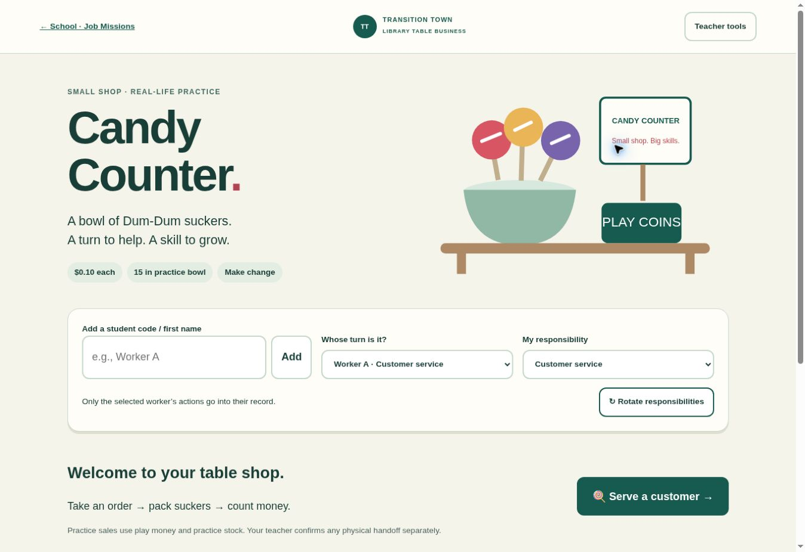

# Candy Counter · optional library-table business

Development branch: `feature/candy-counter`. Entry: `candy-counter.html`.
No automatic merge or deployment is part of this change.

Find it in School Directory → Job Missions (first optional activity), Career & Interview Studio, Miss Kayla’s Office, CDC Student Center, or Student Businesses. Existing games, the original town map, hallway, businesses, payroll and bank records are retained. Money Match's three modes are unchanged; Candy Counter reuses its local U.S. coin and dollar pictures.

## At the library table

Use the extra wrapped Dum-Dums, any bowl or cup, a scrap-paper price sign, an orders tray, and play coins. Nothing requires buying a storefront. Keep actual candy with the teacher until a physical handoff is confirmed.

1. In **Teacher tools**, enter a whole-cent price (1–500¢) and a practice quantity (0–999). The default is 5¢ each with 30 practice suckers. Enter a school and table/group label; each order keeps its original settings.
2. Start with **Count together**: 1–3 suckers per order, picture models, two payment-total answers with money pictures, and optional speech. Try a 1¢ price for a first pennies lesson. **Exact payment** extends to 1–5 suckers. **Make change** supplies the next whole dollar as payment and requires students to build the correct change.
3. Add student codes or first names. Pick **Whose turn is it?** before each student's action. A single student may perform every step. Rotate customer service → inventory worker → cashier between customers. Assign a different responsibility manually when needed.
4. Take the pictured order, count/pack wrapped-sucker pictures into the order tray, identify a coin, tap each payment picture once, select its total, build change, and complete the sale. Add/return controls let the inventory worker organize the order and correct quantities. Retry feedback never skips a failed step. Canceling keeps the attempted-action history without deducting stock or counting a sale.
5. Use **Read step**, **Read aloud**, and **Help me** as needed. Pictures, labels, native buttons and keyboard controls remain usable when speech is unavailable. There is no timer, drag requirement or penalty for retries.

The price remains the teacher's actual configured practice price at every support level. The beginner mode does not silently replace it with a different learning price. Settings are locked until a current customer is completed or canceled.

## Separate stock and records

- A completed sale subtracts only **practice stock**. Completion is idempotent: repeated completion cannot create another sale or deduction.
- **Physical stock tracking is off by default.** It is never driven by student clicks. If enabled, enter a teacher-counted quantity, then choose one completed order in **Optional physical handoffs**, enter the teacher's name, and confirm the actual handoff. Insufficient stock and duplicate handoffs are rejected. Disabling tracking retains the count and ledger.
- Teacher-entered physical counts and confirmed handoffs have their own stock ledger. Simulated sales, payments and change never write to student bank balances, `ttWorld`, business accounts, inventory services, payroll, or other activity records. No session or financial scripts are loaded on this page.
- Only the active worker gets each action. Records capture their role at that moment, school/group, order, support mode, answers, retries and help requests. Changing assignments does not rewrite earlier roles or award team participation. A shared transaction lists only workers who actually acted in it.
- **Teacher-reviewed observations** require the selected student, the support actually observed, a note, reviewer name and an observed/reviewed confirmation. These are separate from app events. The app does not infer independence, mastery, attendance or billable time from clicks or elapsed time.

## Printing and saving

Teacher tools → **Print classroom sales & activity report**. Choose a Central Time activity date (clear it for all dates) and optionally an individual worker. The report includes reconciled simulated totals, completed transactions, individual action histories including canceled attempts and retries, reviewed observations, a clearly separate physical stock ledger, and a blank paper tally / follow-up section. **Print / Save PDF** prints only the report, with repeating table headings and rows kept together.

Individual reports include shared transactions that the selected student acted in. Do not add individual totals together to calculate class sales. Use **All workers** for unduplicated classroom totals. The physical ledger and current counts are classroom-level information even in an individual report; they are labeled accordingly.

Candy Counter is a **teacher-operated, browser-local activity** with no separate sign-in or cloud synchronization. Its isolated key is `ttCandyCounter:v1`. Use student codes on shared devices. The saved state includes unfinished orders, workers, transactions, observations and stock history. **Download activity backup** exports all of that state as JSON; the export is an archive, not an automatic cross-device sync or merge/import tool. Keep the file with classroom records. Reports and local backups must not be committed to the public repository.

Storage-denied or quota-limited browsers retain the current tab's state in memory and show a saving warning. Print/export before leaving. Corrupt saved data is preserved and mutations are blocked; its raw contents can still be exported for recovery. A stale tab cannot overwrite changes from another tab; it must reload first.

## Validation

```sh
node --test tests/candy-counter.test.mjs tests/money-match.test.mjs tests/count-quest.test.mjs tests/job-missions.test.mjs
npm install --prefix /tmp/candy-counter-qa --no-save jsdom@26.1.0
SCHOOL_JSDOM=/tmp/candy-counter-qa/node_modules/jsdom node --test tests/candy-counter-ui.test.mjs
node tests/student-shop-core.cjs
node tests/business-workday.cjs
node tests/business-workday-edge.cjs
node tools/release-audit.mjs
```

The Candy Counter suite covers all 500 supported prices with quantities 1–5; integer tender/change reconciliation; invalid settings; wrong-answer retries; accessible controls; unfinished-order recovery; role attribution; teacher observations; safe printed text; stock separation; single-use handoffs; repeated sale completion; corrupt/denied/quota storage; and concurrent-tab protection. UI tests exercise the actual forms and student buttons, and confirm unrelated bank, business and identity state is unchanged.

The dedicated `Candy Counter checks` workflow runs on the development branch and relevant pull requests, without a deployment step. Browser verification and any remaining limitations are recorded in the pull request.


