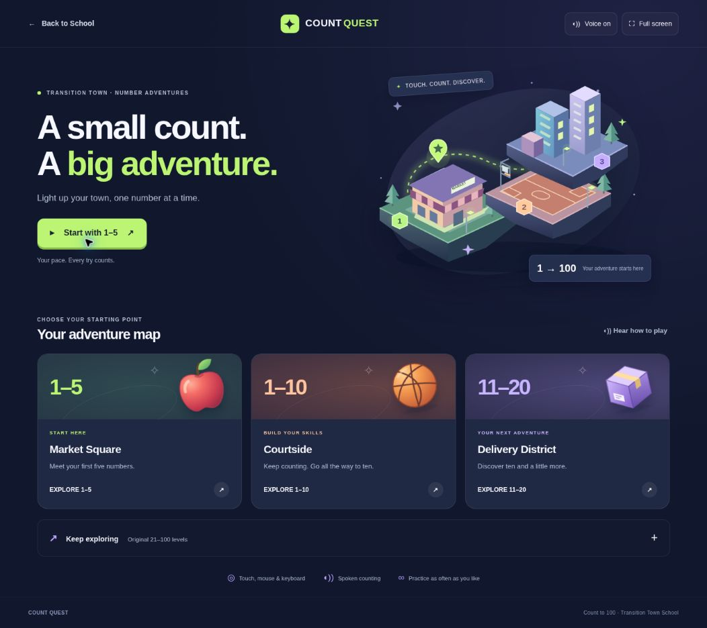
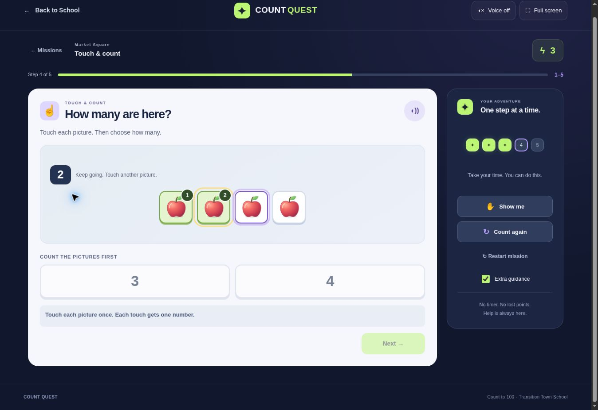

# Count Quest — Count to 100

Review branch: `feature/count-quest-foundations`, based on `1ebb0655494e0a25251c240931dad2601dea631b`. This change is for review; it does not merge, deploy, or change an existing school link.

Open [the portable review copy](count-quest-review.html) in a browser after downloading it. It contains the game, styles, and illustrations in one HTML file and works without a server. Voice still uses the browser's installed speech voices. Its Adventure map link stays inside the review. It does not load classroom monitoring or contact the classroom service. Rebuild it after source edits with `node tools/build-count-quest-review.mjs`.

## Progression

| Number range | Place | Activities |
| --- | --- | --- |
| 1–5 | Market Square | Touch & count, Match the group, Find the number, What comes next? |
| 1–10 | Courtside | The same four activities, restarting at one |
| 11–20 | Delivery District | The same four activities; objects grouped as the first ten and the remaining objects |
| 21–30 | City Lights | Original next-number range and spoken number line |
| 31–50 | Skyline Station | Original next-number range and spoken number line |
| 51–75 | Summit Trail | Original next-number range and spoken number line |
| 76–100 | The Grand Lookout | Original next-number range and spoken number line |

The primary Start button goes directly to one apple. Every counting question begins with no objects selected. Touch any uncounted picture to give it the next counting number. Its picture stays visible and gains a numbered marker; touching it again repeats its assigned number without counting it twice. In 11–20, all objects, including the first ten, are individually touchable: grouping does not require the student to already count by tens.

Students count every picture before choosing a numeral. The first touch cancels an unfinished instruction so the first count can be heard promptly. Rapid counts are queued in touch order; success speech queues after counting. Changing questions, leaving the page, recounting, and muting stop old speech.

Next-number practice in 1–5 starts with “after 1” and finishes at 5; it never demands zero or six. The 11–20 next-number mission connects 10 to 11. The original higher ranges still cover every answer from 21 through 100.

## Support and interaction

- Extra guidance is on by default: two choices and the next uncounted picture outlined. Switch it off for three choices. All number ranges and missions are available without a mastery gate.
- Show me points to the next uncounted object. After counting, or in other activities, it outlines the correct choice and explains it. Numeral help also supplies a picture group.
- After two incorrect answers, the same support appears automatically. Incorrect answers remain retryable; the question and completed object count stay in place. There is no failure limit or lost score.
- Count again resets object selection and keeps the question's attempts/help history. Restart mission and Practice again begin a fresh visit-level mission with newly positioned answer choices.
- Correct answers lock once and award one town light. Every transition waits for Next; there is no timed response or automatic next-question delay. Finishing offers the next skill, then the next range as a suggestion, not a mastery claim.
- Native buttons work with mouse, touch activation, Enter, and Space. Counting pictures are at least 44px high at narrow sizes. Read-aloud controls, focus outlines, live feedback, optional instructions, a voice toggle, full-screen controls, and reduced-motion styling are included. Instruction reading can be disabled while leaving spoken object counts available.
- Artwork is local SVG. No external font, image-generation service, or paid runtime API is required. The new game files use no external dependencies.

Progress and game rewards last for the current visit only. They do not change bank balances, pay, grades, accounts, or assessment records.

## Classroom monitoring and navigation

`count-to-100.html` keeps the existing `transition-town.html?school=1` Back to School destination and the classroom-monitor script. No school, directory, or town files change.

The existing monitor's allowed-page expression previously excluded Count to 100, despite that page referencing the script. This patch adds only `count-to-100` to that expression. Existing teacher control, student identity, device approval, notices, pause/end, recording settings, retention, and mirror behavior remain in the shared monitor.

The game sends existing supported event kinds for starts, retries, requested/automatic hints, recounts, and confirmed correct answers. Summaries include the number range, activity, target quantity, attempt count, game-help use, and extra-guidance mode. They explicitly say teacher prompting is not assessed. A correct game response or lack of a help-button press is never described as independent mastery. No service, database, teacher authorization, or student roster change is part of this patch. No actual classroom sessions or student test records were created during verification.

## Verification

Automated checks passed:

- `node --test tests/count-quest.test.mjs` — nine tests; every range/mode at two and three choices across 150 random seeds; unique/in-range answers; exact coverage; one count per object in reverse order; 30 consecutive errors per question; prompting, recount/reset and duplicate-credit behavior; speech wording 1–100; routes/assets; monitor boot on the intended page with no anonymous network activity; portable review compilation and isolation.
- `node --test tests/money-match.test.mjs` — eight existing tests.
- `node tests/classroom-monitor.cjs` — 85 existing evidence, access, session, signaling and concurrency assertions.
- `node tests/classroom-multiview.cjs` — existing multiple-view regression checks.

Browser playthroughs in cloud Chromium passed:

- All four 1–5 missions, with intentional incorrect answers, five repeated incorrect counting answers, automatic and requested hints, recounting, duplicate picture taps, and Enter/Space operation.
- Every counting question in 1–10 and 11–20, including all 20 touchable packages; pointer and keyboard activation were used.
- Every original next-number question from 21 through 100.
- Quiet play, two/three-choice changes while a question is in progress, visible progress/finish summaries, and loaded illustrations.
- Home and play layout at **iframe sizes** 1366×768, 1024×600, 768×1024, 390×844, and 683×600: no horizontal document overflow. These are browser layout checks, not physical hardware tests. Normal vertical scrolling is available.

Device limitations: the cloud browser has no working speech voice, so audible output could not be verified. The game reports that condition visibly and keeps the visual activities usable. A request for optional bundled narration was rejected by HeyGen due to a workspace voice-engine restriction; no audio asset was created or referenced. Full-screen requests were also unavailable in the cloud browser and were handled without interrupting play. Physical school Chromebook/touchscreen activation, installed voices and audible count timing, Safari, and a signed-in live classroom mirror remain school-device checks before release. The standard device speech path remains the game's audio implementation.

A PR-only GitHub workflow runs these logic and regression checks. It contains no deployment step.
