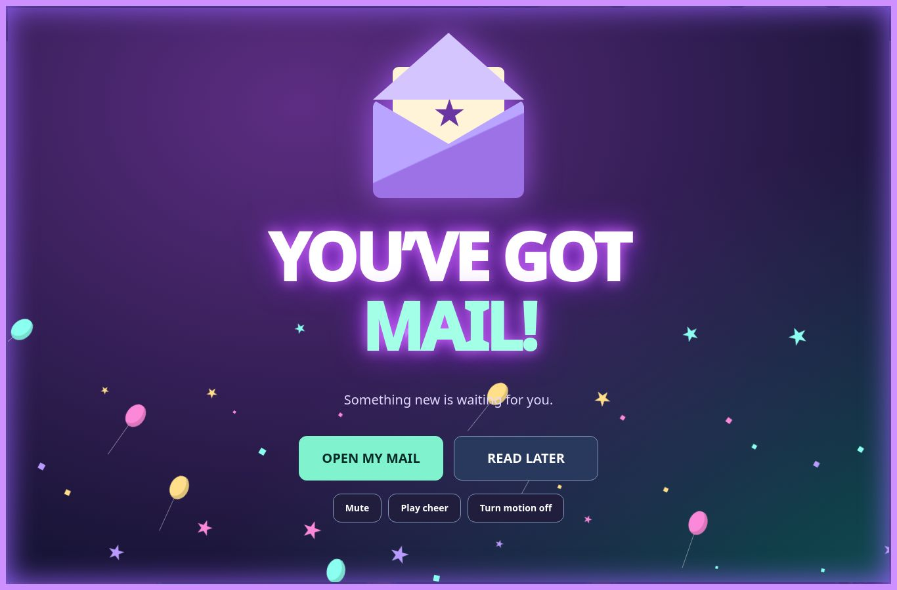
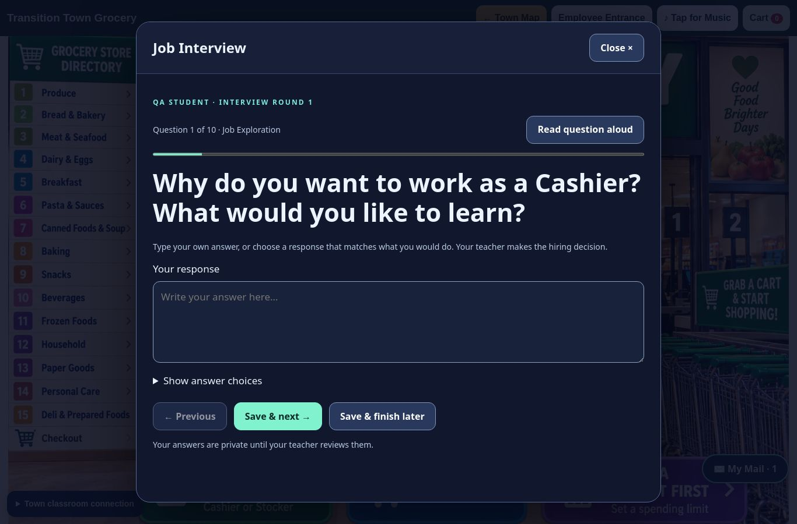
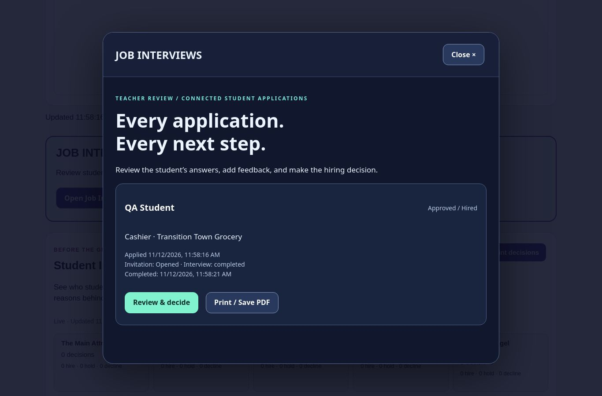
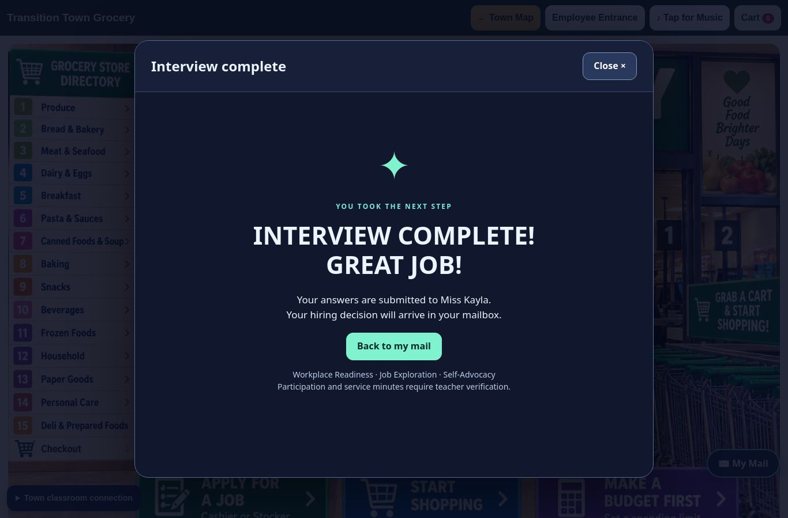
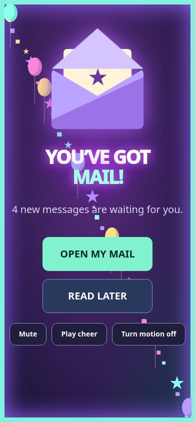

# Mailbox and interview review evidence

All fixtures are fictional. No live student rows were read, changed, or used in tests. The only production inspection was service source and schema metadata, without student-row contents. No production schema, function, or frontend deployment was performed.

## Passed locally

- **114 new assertions** using the actual classroom Edge handler and the proposed SQL in PostgreSQL/PGlite: application receipts, invitation/decision transactions, exact retry handling, account isolation, unapproved/expired/revoked devices, ordinary classroom-token rejection, partial answers, completion, separate-device resume, stale concurrent saves/decisions, second-round history, broadcasts, phone-to-mail routing, repeat billing cycles, all 21 question sets and direct-table/RPC denial for anonymous/authenticated clients.
- **Actual browser workflow:** submitted the existing grocery Cashier application; approved a fictional mailbox device; requested an interview from the existing Central Hub; received the full-screen celebration; selected READ LATER (message stayed unread; no repeated celebration); opened the invitation; used typed and supported answers; saved and resumed on a separate browser storage context; submitted ten answers; reviewed actual responses on the teacher dashboard; hired the student; received the decision; logged out through the real Town logout hook; paired again and recovered the saved decision and Cashier employment entry.
- A simulated lost network response **after the database saved** preserved the on-screen answer and reused the original command on retry, without a second write.
- Another fictional student's mailbox remained empty. Separate-browser tests use independent Chromium contexts, not copied cookies/localStorage.
- Native dialog keyboard navigation, Enter to OPEN MY MAIL, reduced motion, desktop and 390px phone screenshots, and unchanged checking/savings balances passed. No unhandled page errors in the final browser run.
- Printed the actual teacher report DOM to a three-page Letter PDF. Questions, typed/choice modes, completion, feedback and the no-automatic-minutes statement are present. The rendered first page was visually inspected; text extraction confirmed all ten questions across the PDF.
- Existing regressions passed: 101 classroom identity/report assertions; 17 name-sign-in assertions; 65 pricing-stage checks; 59 shop/banking checks; 97 workday checks; 24 shared-handler checks; 28 payday DOM checks; the Transition Life core suite; and nine school workflow tests.
- Whole-site local reference and JavaScript audit: no syntax failures or missing active references. `git diff --check` clean.

The local full Chromium executable could not start because of a restricted IPC socket. The tests were completed successfully with the pinned Playwright 1.51.1 headless-shell build instead. This does not claim physical school-device or other-browser-engine certification.

## Review previews

[Fictional completed interview report](evidence/fictional-interview-report.pdf)

## Still requires approval / classroom verification

The shared schema and updated service remain a proposal. Cross-computer production delivery cannot be claimed until that coordinated rollout is approved and performed. Recheck with a dedicated non-real test student on two school devices, the district's browser/audio policies, actual printer, and the existing teacher pairing screen. Review the retention/export policy and uncertain legacy application bindings first. Do not merge or publish based only on these fixture results.
