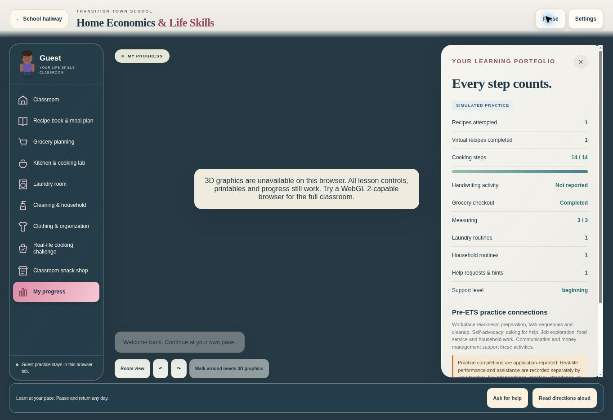
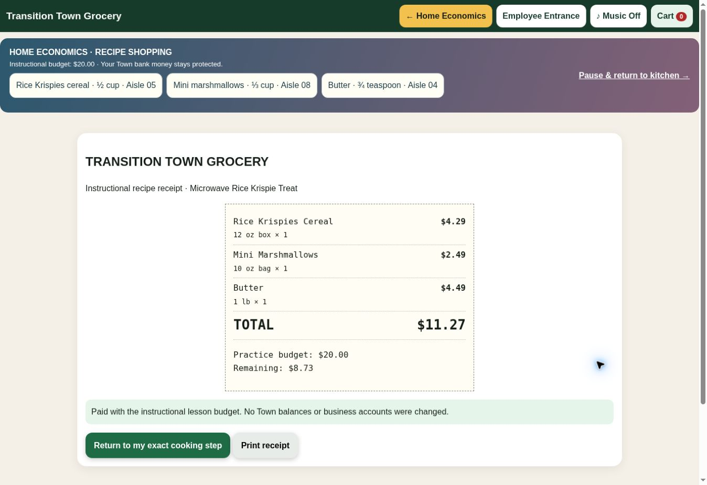

# Home Economics review-build verification

Test date: November 1, 2026, America/Chicago. Development branch: `feature/home-economics-3d-center`. Main inspected at `7775dce`; draft PR #11 at `3bce6b2`. Candy Counter reuse is from draft PR #8 at `3ab3abb`.

## Verified

| Area | Evidence |
| --- | --- |
| Original school | Browser entry through the original Town and hallway; new additive door visible. Original map, hallway image bytes and other doors retained. Only asset-version references change in the Town page. |
| Browser recipe workflow | Guest entry, individual ingredients/tools, recipe book, instructional trip, cereal/marshmallow/butter selection in the existing store, item-by-item checkout, $11.27 payment from a $20 lesson budget, receipt and return to the cooking checkpoint. |
| Browser cooking | Safety reminders, 20-second handwashing, cabinet/tool controls, a rejected over-measurement, correct ¾ tsp butter, ⅓ cup marshmallows, combine, adult-help request/mitts, two short heat-and-stir sequences, ½ cup cereal, eight stirs, transfer, cooling, four washed tools, five wiped sections, supply storage, reflection and real-life challenge. |
| Resume / modes | Refresh retained 14/14 cooking steps, completed recipe, receipt and support. Mode controls share that checkpoint. Actual 3D walking is **not** certified by this check. |
| Grocery isolation | DOM tests execute the actual original register plus the bridge. Banks, businesses, ordinary cart, grocery budget/mode and original purchasing path are checked separately. Duplicate payment, changed identity, incomplete list and malformed/mispriced/over-budget products are rejected. |
| Music | Browser showed the blocked-autoplay entry button on first store entry and allowed the existing radio after a user entrance interaction. DOM tests verify fallback, one audio element and no replacement player. Sound quality and all mobile autoplay policies remain unverified. |
| Teacher records | DOM test sends one confirmed, individually supported real-world checklist through the existing protected observation action. Existing service tests cover role checks and rejection of student-forged observations. No live teacher record was written in QA. |
| Laundry / household | Automated full routines cover all ten laundry stages and all seven household sequences, including incorrect settings/amounts and ordered completion. Browser practice also completed sorting, labels, loading, detergent retry, washing, lint/low heat, drying, folding and storage, followed by a separate bed-making routine. Pause survived a refresh and resumed without losing progress. |
| PDFs | All 8 files / 11 pages rendered with Poppler and visually inspected; the independent directions page was re-rendered after expanding to twelve writing lines. No completed student answers embedded. |
| 3D construction | Real Three.js geometry tests construct the classroom and grocery shelf, check finite coordinates, bounded mesh/triangle counts, required pickable objects, camera presets, separate microwave door and bowl raycasting. These are geometry tests, not GPU screenshots. |
| Regression | Existing school learning, Candy Counter, five-business bank/workday and classroom evidence/access suites run without production writes. |

Automated result: **57 tests passed** across Home Economics, its actual DOM integrations, Three geometry, Candy Counter and school learning. Existing business/bank/workday and classroom monitor suites also passed **241 assertions** (59 + 97 + 85). Static audit: **207 HTML pages, zero missing local references**.

## Release blockers and limits

- **3D visual acceptance is pending.** The preview browser reports disabled WebGL and cannot create a context. No genuine browser screenshot of this new 3D classroom was obtained. A separate Blender executable was also unavailable for rendering in this environment. No generated mockup or static image is presented as an implemented classroom screenshot.
- Camera movement, collision feel, object highlighting, stirring gestures, reflection/shadow quality, loading time, frame rate, context-loss recovery and long-session GPU stability need manual checking in a WebGL 2-enabled browser.
- Real iPhones, tablets, school laptops and projector layouts have not been certified. Responsive CSS, resolution caps, large controls and projector text are implemented; they do not substitute for those checks.
- Private production teacher sign-in and observation submission need a teacher-approved classroom trial. QA used isolated DOM/service fixtures and Guest browser practice, never real learner records.
- Physical printers, native PDF print dialogs, actual handwriting, food preparation, real appliance safety and observed individual performance require classroom validation.
- Additional recipes are intentionally labeled future content. Only the individual Rice Krispie treat has a complete cooking sequence in this build.
- Local checkpoints do not sync between student devices. Existing approved-device events use the existing monitor; extended connected logging uses its group workflow. No replacement database or service is introduced.

## Review gates

1. Review the PR and run the branch locally in a WebGL-enabled browser. Compare the actual classroom, counter close-ups, grocery shelves and laundry room against the approved glossy reference.
2. Test the full loop in both navigation modes and at phone/tablet/laptop/projector sizes. Check a second student profile and a paused multi-day lesson.
3. On an approved classroom device, verify the teacher checklist and Pre-ETS evidence separation. Print each learner level once.
4. Approve merging and deployment separately. This branch has neither been merged nor deployed.

## Browser evidence

