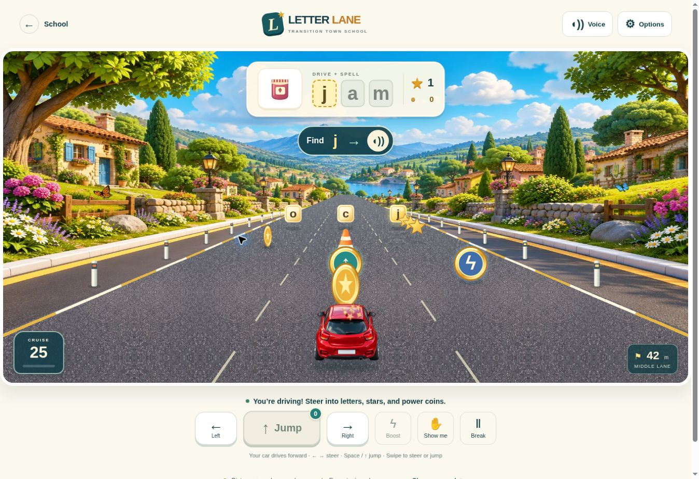

# Letter Lane · Continuous Driving

Open `letter-lane.html` from School → The Wow Zone, the original school game menu, CDC Student Center, or Digital Game Zone. The car now drives continuously: students steer into approaching letters, stars, and power coins. Pickups are collected by physical crossings in the road simulation. There are no clickable letter-choice tiles or a Drive-to-answer button.

## Road and powers

- Left/right steering moves the car across three lanes. Letters, coins, stars, cones and roadside markers approach in perspective while the road scrolls beneath the car.
- **↑ jump coins** add two jumps, with up to four stored. Jump, Space, up-arrow or an upward swipe uses a charge and lifts the car. A cone can be jumped over while the car is high enough.
- **ϟ lightning coins** give six seconds of boost fuel and turn on a faster driving speed. Boost can be switched off/on while fuel remains. Fuel is consumed only during active boosted travel.
- Stars and coins are earned only by driving into them. Letter collection does not add unseen road stars. These pickups are separate from Town money.
- A cone bump briefly slows the car. It never removes stars, letters or coins. A missed/wrong letter returns on a later road row; there is no game-over timer or lost progress.
- Complete a three-letter word to stop for its spoken review and celebration, then choose the next drive or replay.

Word pictures: **jam, cat, sun, bus, cup, dog, hat, map, pig, bed, pen, hen**.

## Support choices

| Mode | Spelling support |
| --- | --- |
| Follow me (default) | Picture, spoken word/letter, printed word, glowing correct pickup, and a lane arrow/spoken lane cue. The student still steers. |
| Find the letter | Picture, spoken word/letter, printed word; no answer glow or lane clue until help is requested. |
| Spell it | Picture and spoken word. Uncollected slots and next-letter clue are concealed until Show me is used. |

Slow & steady is the default speed; Cruise is available. Optional **Help me jump** uses a stored jump when a cone is close and records that assistance separately. It is off by default. Capital/lowercase letters and less extra motion are available. Reduced-motion preference suppresses cosmetic effects; the actual driving motion remains part of this game. Changing spelling mode/case starts a fresh word. Pace and jump assistance can change without discarding a word.

## Controls and voice

- **Steer:** left/right buttons, left/right arrow keys, number keys 1–3, sideways swipe/drag, or tap a section of the road. A road tap steers the car; it never directly collects a letter.
- **Jump:** Jump, Space, up arrow, or an upward swipe, after collecting a jump coin.
- **Boost:** Boost, B, or down arrow, while fuel remains.
- **Break:** pause button, P, or Escape. Leaving the tab pauses driving. Resume restores the road, powers and word position.
- **Hear/Show me:** repeat instructions or reveal the target letter/lane. Word pictures, progress, status and controls are accessible DOM elements; the animated road uses canvas.

Device speech is preferred. A bundled local MP3 sprite provides 56 recorded synthetic voice cues if device speech fails or never starts. This includes words, letter names, lane directions and power instructions. It requires no paid service or API key. Browser autoplay settings still apply; actual speaker output on the user’s iPhone has not been verified.

## Records and compatibility

The existing `learningStore('letter-lane')` remains separate from `ttWorld`, profiles, financial balances and business ledgers. Old practice records remain readable. Incomplete version-1 words migrate with their already-earned letters/stars. Version-2 checkpoints preserve the road position, item IDs, pickup ledger, jumps, active jump pose, boost fuel, responses and word progress. Earned items cannot be collected twice after resume.

Only physical letter collisions create spelling responses. Missed rows are kept distinct from wrong-letter responses. New completion summaries include physical stars/coins, cone bumps, manual/assisted jumps, missed rows, distance, speed and spelling support. Existing teacher-approved classroom monitoring receives practice events. Matching with a clue, assisted jumps and completing a word are not labeled independent reading/spelling mastery.

The original scene/car art, school menus and other activities remain. Legacy entry code/audio remain for compatibility with cached earlier pages; the current page loads `drive-game.mjs` with a new cache version.

## Verification

- 32 focused tests across driving, spelling/voice and Count Quest passed; 85 existing monitor assertions and multiview regressions also passed.
- Driving tests cover automatic forward travel, real lane collisions, all 12 words, repeated/missed letters, independent star pickups, jump charge use and cone clearance, cone slowdown, boost fuel/expiry, pause, variable frame rates, idempotent completion and corrupt-checkpoint rejection.
- Resume tests include old progress migration and a car already in mid-jump. Driving narration tests verify that ability cues use the correct audio sprite.
- Browser: physically completed JAM with 9 stars and 5 coins; collected a lightning coin and observed speed rise from 25 to 43; manually jumped and verified a 72px lifted car pose and spent charge; pause stopped motion and voice; a reload retained progress, coins and jump charges.
- Browser pointer gestures: sideways drag changed the lane, upward drag used one jump. Phone layouts at 320 and 390, plus tablet at 768, were checked. At the smallest checked viewport the document and client widths both measure 305px, and all six driving buttons measure at least 44px wide.
- Browser QA used Guest practice and did not create real student classroom records.

## Original artwork

Created with the built-in image-generation tool. Final project assets are `assets/letter-lane/landscape.webp` and `assets/letter-lane/car.webp`. The background is optimized WebP; the car preserves transparency. The word pictures are original code-native SVG illustrations in `pictures.mjs`. No PBS artwork, characters, logos, or code are included.

Background prompt:

> Use case: stylized-concept. Asset type: finished background for an accessible school spelling-driving browser game, landscape 1536x1024. A beautiful polished 3D animated-film style sunny storybook town beside a gentle road, lush rounded emerald rolling hills, tall sculpted trees with individual leaves, tiny warm pastel houses, flowering verges, a distant blue mountain, puffy sculpted white clouds in turquoise sky, subtle butterflies and colorful flowers. Rich detailed toy-like materials, ambient occlusion, soft sunshine, vibrant but elegant high-end family game art. Camera looking forward above a car, central one-point perspective, vanishing point EXACTLY in center at 40% image height, unmarked wide slate-gray paved road coming from that point widening in straight lines to BOTH lower corners of image; road empty, no cars, no people, no letters, no UI or words. White-and-yellow road edging and scenic village details confined to outer thirds, keep center road visually clear for interactive letter pickups that will be coded separately. Foreground not cropped with a dashboard. This must look like a fully realized inviting game world rather than geometric clip art. No logos, no watermarks, no text.

Car prompt:

> Use case: stylized-concept. Asset type: a single high quality transparent game vehicle sprite. One adorable but age-respectful detailed glossy cherry-red compact sporty hatchback seen DIRECTLY FROM BEHIND AND SLIGHTLY ABOVE, symmetrical centered, car pointed AWAY from viewer as though driving down a road. Three-quarter elevated REAR view shows roof and wide rear window, no front or side face. Beautiful 3D game asset, convincing rounded automobile body, glossy red paint, black rubber tires, silver wheel rims, rear red taillights with amber indicators, rounded rear bumper, wide dark teal rear window with subtle sky reflection, rear license plate blank. Full vehicle clearly contained in image with generous transparent margin, no ground plane, no surroundings, no road, no person. Real transparent alpha background, no checkerboard drawn, no text, no watermark. Single car only, polished family video game quality.

## Rebuild the driving voice

Run `python tools/build-letter-lane-audio.py --driving` with FFmpeg and its libflite filter installed. The CMU SLT synthetic voice produces `assets/letter-lane/driving-voice.mp3` and `driving-cues.mjs` (56 clips, about 114 seconds total, 686 KB). No network speech service or voice cloning is used. Without `--driving`, the script retains the original 47-clip fallback build for legacy pages.
