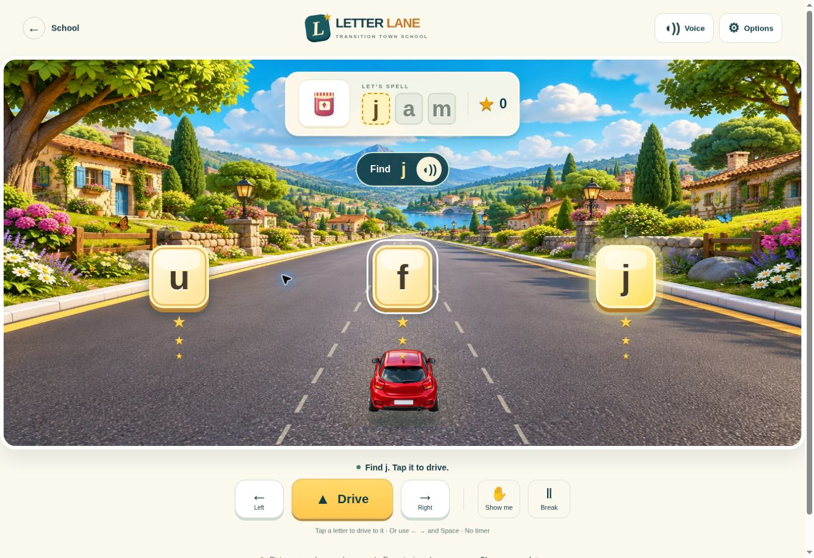

# Letter Lane

Open `letter-lane.html` from School → The Wow Zone, the school’s original Educational Games menu, CDC Student Center, or Digital Game Zone. This is an additional activity; the existing town, hallway, profiles, businesses, balances, and games are retained.

The default first drive spells **jam**. A student hears the word, sees its picture, and taps a letter to steer the car to it. Each collected letter earns three stars. Wrong choices leave the word position and stars intact. Pickups wait for the student; there is no timer, crash, or failed round.

## Practice options

| Mode | Support |
| --- | --- |
| Follow me (default) | Picture, spoken word and target letter, printed word, arrow and glow on the correct pickup. |
| Find the letter | Picture, spoken word and target letter, printed word; choices have no answer glow until help is requested. |
| Spell it | Picture and spoken word; uncollected slots and next-letter clue are concealed. “Show me” reveals the next letter and marks that slot as supported practice. |

Word pictures: **jam, cat, sun, bus, cup, dog, hat, map, pig, bed, pen, hen**. Options include capital/lowercase letters and less movement. System reduced-motion preference is honored. Change support or case to begin a fresh word. The word is spoken and spelled again on completion; the student chooses the next drive or a replay.

An adult can begin by modeling a word, saying its sounds with the student, and using Follow me. The game practices picture-word association, letter identification, and letter order. Supported matching and a completed word are not evidence of independent reading or spelling. The practice history identifies the support used.

## Controls and accessibility

- Tap a letter for a single-action steer and collect. Dragging is not required.
- Left/right arrow keys steer; Space on Drive collects. Number keys 1–3 select the matching road lane. Letter buttons also work with Tab and Enter/Space.
- Picture and speaker buttons repeat the word or instruction. Show me supplies the next-letter clue. Break pauses play; leaving the tab pauses it too.
- The driving world is decorative canvas. Letters, prompts, controls, counters, and picture choices are accessible DOM elements. Progress announcements are event-based, with no per-frame screen-reader updates.
- Device text-to-speech is preferred. If it fails or never starts, 47 bundled voice clips supply word names, letter names, directions and celebrations, without an API key or paid service. The backup uses a single local MP3 sprite with explicit cue times; cancellation prevents an old prompt from restarting after a break or another prompt. Browser autoplay settings still apply. Actual speaker output on the user’s iPhone has not been verified; browser playback of the backup was verified.

## Records and classroom connection

Uses the existing separate `learningStore('letter-lane')`. Records belong to the active Town identity on this device, with Guest practice in session storage. Checkpoints allow a partially collected word to resume after a reload. Invalid checkpoints are rejected. A player change cancels the current drive before further credit. No `ttWorld`, business ledger, or balance writes are made.

Each actual attempted pickup records the response, expected letter, correctness, position, mode, capitalization and whether the letter clue was shown. A word summary records attempts, retries, supported letters and stars. Completion IDs are idempotent. When an existing teacher-approved device session is active, the existing classroom monitor receives corresponding practice events. Teacher observation and independent mastery are not inferred. The current-player history in Options is local practice history, not a new teacher authentication system.

## Verification

- `node --test tests/letter-lane.test.mjs tests/count-quest.test.mjs`: 19 passed.
- `node tests/classroom-monitor.cjs`: 85 report-evidence, identity, access, signaling, session and concurrency assertions passed.
- `node tests/classroom-multiview.cjs`: existing multiview checks passed.
- New scripts pass `node --check`.
- Browser: wrong-letter retry with no lost stars; complete JAM with 9 stars; capital CAT in Spell it with one clue recorded; support/case changes after completion; steering, Break/resume; reload at 1/3 letters resumes at 1/3 and 3 stars.
- Responsive browser frames: 320×760, 390×844, and 768×1024, plus desktop and an 1180×800 classroom laptop frame (controls end at y=747). Narrow-phone overflow was corrected; the checked 320 frame has equal document/client widths. Browser verified the recorded voice playing with media ready-state 4, stopping on Break, and continuing through completion when device speech was unavailable. Browser checks use Guest practice, with no real student identities or production classroom records.

## Original artwork

Created with the built-in image-generation tool. Final project assets are `assets/letter-lane/landscape.webp` and `assets/letter-lane/car.webp`. The background is optimized WebP; the car preserves transparency. The word pictures are original code-native SVG illustrations in `pictures.mjs`. No PBS artwork, characters, logos, or code are included.

Background prompt:

> Use case: stylized-concept. Asset type: finished background for an accessible school spelling-driving browser game, landscape 1536x1024. A beautiful polished 3D animated-film style sunny storybook town beside a gentle road, lush rounded emerald rolling hills, tall sculpted trees with individual leaves, tiny warm pastel houses, flowering verges, a distant blue mountain, puffy sculpted white clouds in turquoise sky, subtle butterflies and colorful flowers. Rich detailed toy-like materials, ambient occlusion, soft sunshine, vibrant but elegant high-end family game art. Camera looking forward above a car, central one-point perspective, vanishing point EXACTLY in center at 40% image height, unmarked wide slate-gray paved road coming from that point widening in straight lines to BOTH lower corners of image; road empty, no cars, no people, no letters, no UI or words. White-and-yellow road edging and scenic village details confined to outer thirds, keep center road visually clear for interactive letter pickups that will be coded separately. Foreground not cropped with a dashboard. This must look like a fully realized inviting game world rather than geometric clip art. No logos, no watermarks, no text.

Car prompt:

> Use case: stylized-concept. Asset type: a single high quality transparent game vehicle sprite. One adorable but age-respectful detailed glossy cherry-red compact sporty hatchback seen DIRECTLY FROM BEHIND AND SLIGHTLY ABOVE, symmetrical centered, car pointed AWAY from viewer as though driving down a road. Three-quarter elevated REAR view shows roof and wide rear window, no front or side face. Beautiful 3D game asset, convincing rounded automobile body, glossy red paint, black rubber tires, silver wheel rims, rear red taillights with amber indicators, rounded rear bumper, wide dark teal rear window with subtle sky reflection, rear license plate blank. Full vehicle clearly contained in image with generous transparent margin, no ground plane, no surroundings, no road, no person. Real transparent alpha background, no checkerboard drawn, no text, no watermark. Single car only, polished family video game quality.

## Rebuild the voice backup

Run `python tools/build-letter-lane-audio.py` with FFmpeg and its libflite filter installed. It uses the built-in CMU SLT synthetic voice to create `assets/letter-lane/voice.mp3` and `voice-cues.mjs`. No network service or voice cloning is used. The MP3 contains 47 separated clips (about 81 seconds total, 484 KB).
