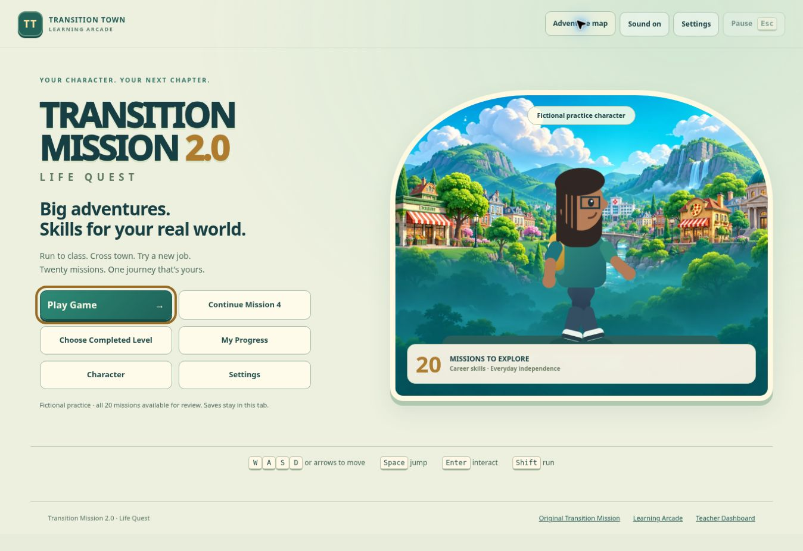
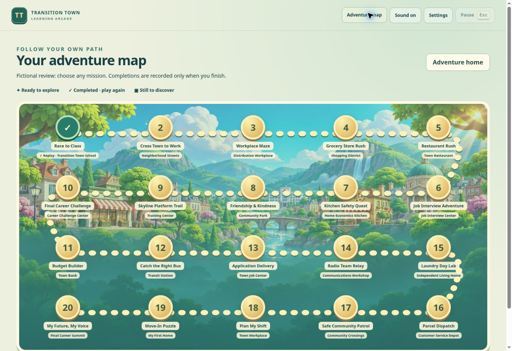
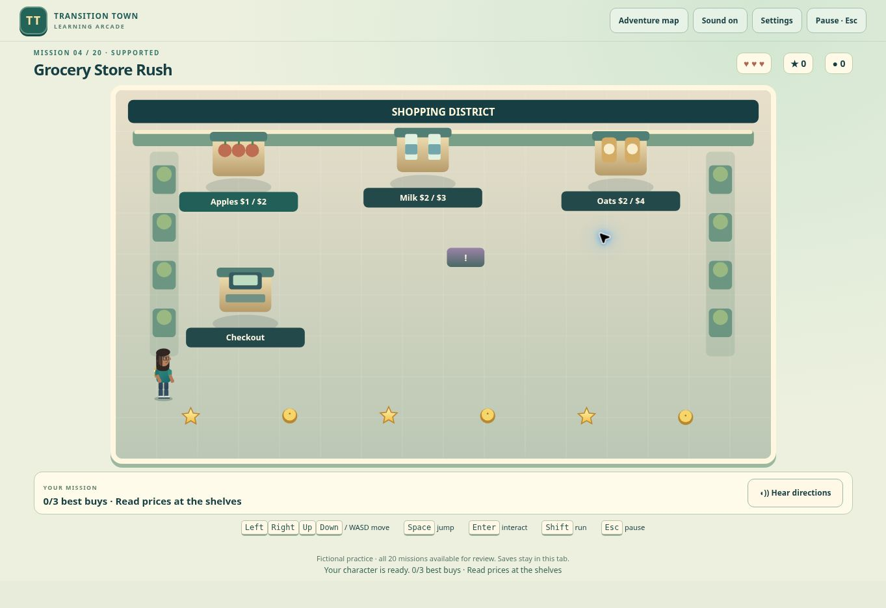
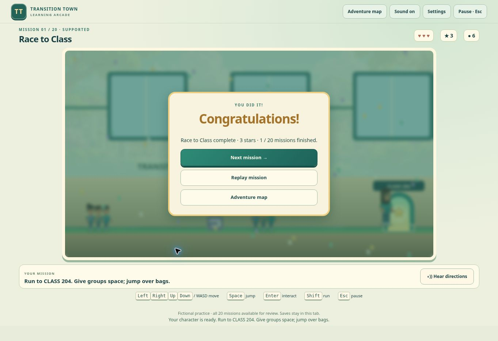
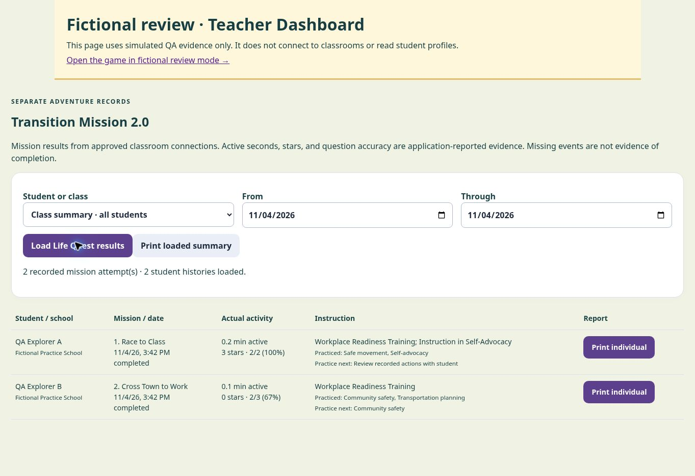

# Transition Mission 2.0 — Life Quest

Twenty playable career and independent-living missions, built as a separate canvas game. The original `transition-mission.html` and every file in `assets/transition-mission/` are unchanged. Its avatar renderer, original synthesized sound, and valley artwork are reused as read-only dependencies.

## Review before deployment

This branch is for review. It does not deploy the game, change a database, migrate a roster, or modify student financial records.

1. Check out `feature/transition-mission-2-life-quest`.
2. Serve the repository as a static site, for example with `python -m http.server 8000`.
3. Open `http://localhost:8000/transition-mission-2.html?practice=1`.
4. Choose **Play Game** to review any of the 20 missions. This explicit practice mode uses a fictional character and a separate tab-only save. It never loads the classroom recorder or reads real student profiles. Merely visiting a mission does not mark it complete.
5. For the reporting interface without a teacher login or live data, open `http://localhost:8000/tests/life-quest-teacher-preview.html`. Click **Load Life Quest results**. The page clearly labels all evidence as fictional QA simulations.
6. For a local integration check, use fictional `ttCurrent` and `ttWorld.residents` fixtures. Do not use live student records. Normal mode reads the same login and avatar fields as the existing Town.

After a separately approved deployment, the game appears beside the original on the WOW Zone shelf, the existing school game menu, and the Game & Simulator Zone. No hallway shortcut buttons are added. Its home offers Play Game, Continue Adventure, Choose Completed Level, My Progress, Character, and Settings.

## The missions

| # | Mission | Playable mechanic |
|---|---|---|
| 1 | Race to Class | Side-scrolling hallway; jump bags, avoid groups, reach classroom 204 |
| 2 | Cross Town to Work | Four independently moving traffic lanes and safe islands |
| 3 | Workplace Maze | Alternating shelf corridors, six supplies, a key, and patrol carts |
| 4 | Grocery Store Rush | Find three shelves, compare equal-size prices, fill the list, check out |
| 5 | Restaurant Rush | Pick up the current meal and deliver it to its matching table |
| 6 | Job Interview Adventure | Gather résumé and badge; use the appointment to find room 3 |
| 7 | Kitchen Safety Quest | Wash, collect fruit and yogurt, mix, serve; avoid hazards |
| 8 | Friendship & Kindness | Meet three characters, choose support, open the kindness bridge |
| 9 | Skyline Platform Trail | Gaps, a moving lift, patrol obstacles, and a midpoint checkpoint |
| 10 | Final Career Challenge | Longer run → denser road crossing → workplace kit delivery |
| 11 | Budget Builder | Assemble exactly $6, pay $4 transit, reserve $2 savings |
| 12 | Catch the Right Bus | Board the stopped Training bus and ring at the correct stop |
| 13 | Application Delivery | Build availability, honest strength, and reference cards; submit |
| 14 | Radio Team Relay | Follow changing dispatch instructions in the correct delivery order |
| 15 | Laundry Day Lab | Carry and sort light/dark shirts, start a cycle, wait, hang clothes |
| 16 | Parcel Dispatch | Intercept moving requested parcels and dispatch to matching bays |
| 17 | Safe Community Patrol | Request WALK, wait for the signal, cross the strip, report a barrier |
| 18 | Plan My Shift | Complete clock-in, stocking, break, and clock-out appointments in order |
| 19 | Move-In Puzzle | Push-only box puzzle with storage goals, walls, and an R reset |
| 20 | My Future, My Voice | Request three specific supports, open the summit gate, navigate hazards |

Each mission has two required, original real-life decisions at its exit event, with explanations after mistakes. Grocery, application, kindness, and advocacy decisions also affect physical objectives. Incorrect scored actions and responses remain in the evidence; a correction does not erase the first attempt. Game stars, coins, and points have no financial effect in Town.

## Keyboard and supports

- Arrows or WASD move; Space jumps; Enter interacts; Shift runs; Escape pauses. Tab remains native for menus and dialog choices. The box puzzle also uses R to reset just the puzzle.
- Settings remap the seven game actions, change movement speed, select Supported/Adventure/Challenge, and offer an optional timer. Escape and Tab remain reserved. R is reserved for puzzle reset.
- Supported mode slows hazards, assists obstacle jumps, and helps across gaps, including at gentle speed. Adventure and Challenge require the player to time jumps and avoid collisions. Later missions add longer routes, denser traffic, faster patrols, sequencing, timing, and multi-part objectives.
- Reduced motion stops extra bobbing, confetti, arrival effects, and the home character's idle animation. Movement needed to play remains visible.
- Optional browser speech, original synthesized music, reward effects, sound off, and volume controls require no external audio service. Speech availability depends on the browser.
- Settings and report dialogs stop gameplay timing. Decision dialogs count participation for up to 30 seconds after input. Hidden tabs, pause, and inactivity over 30 seconds do not add active seconds.

## Identity, character, and progress

The game reads only the current login's Town avatar colors, hairstyle, outfit, and supported glasses. Assigned business portrait artwork uses the original Mission's rendering/cropping approach. A compatible character is supplied when no avatar exists. The same character appears in every playable scene. Character editing goes to the existing Town creator, where the student explicitly saves a profile change; Life Quest never saves an avatar into Town.

The existing `learningStore` uses the separate `transition-mission-2` activity namespace. Identity changes lock the game, stop audio, and clear report content. Saves checkpoint positions, objectives, lives, questions, rewards, current mission, attempt evidence, settings, completion times, and active time. Unfinished missions are suspended when replaying an earlier level, so returning restores their work. Failure never removes completed missions. Road hits and relay failures restart only that mission; three lost lives elsewhere restart only the current mission. Platform checkpoints support ordinary single-life retries.

### Architecture limits and the compatible approach

**Adventure saves are on this browser/device.** They are not cross-device cloud saves. Guests and the explicit fictional review mode use tab storage. If browser storage is blocked, corrupt, or full, the UI explains that saving is unavailable; corrupt data is kept rather than silently overwritten. Reports can still be printed from the current session.

**The existing name-based Town login is not secure student authentication.** Per-profile keys and identity guards prevent accidental cross-profile loading/writes through this game, and it provides no UI to browse other students' local history. A person with access to the same browser storage, developer tools, or another student's selected Town identity can still inspect or alter browser-local data. This static architecture cannot honestly guarantee tamper-proof student identity or records. Separate OS/browser profiles provide a practical shared-device boundary; stronger isolation and cross-device saves need a separately designed authenticated student backend. This branch does not weaken existing authentication or claim local saves are secure cloud records.

**Private dashboard evidence uses the existing approved-device classroom service.** The service binds events to the device's student identity and authenticates teacher reads. No public student reporting endpoint, service credential, new table, or schema is introduced. The new game does not query other students' data. Missing recording permissions or an unavailable connection do not fabricate dashboard results. The student-device report remains available.

## Teacher reporting

The authenticated dashboard has a separate **Transition Mission 2.0** category. It loads actual retained history for a selected student or the roster, within dates interpreted in America/Chicago, including daylight-saving boundaries. It shows school, mission, status, date, active duration, stars, question accuracy, relevant Pre-ETS categories, and skills needing practice. It supports an individual printout and a class summary.

The game sends compact snapshots every 15 seconds while open, at recorded decisions, at pause/exit, and at completion, plus individual action/response evidence. All fields pass through the existing classroom service allowlist. Event summaries are browser-reported evidence, not teacher observations. A completed event is required for dashboard completion; visits and clicks never become completions. Duplicate snapshots do not multiply attempts. The student report contains the complete locally recorded activities; classroom reports contain only events actually received and retained by the service. Existing retention, pauses, authorization, and connection limits apply.

During review, no live classroom/device authorization or database recording was exercised. The existing sanitizer and teacher UI were tested against fictional evidence. School-device network and approved-device end-to-end verification remain part of the deployment pilot.

## Files and integration boundaries

- `transition-mission-2.html` and `assets/life-quest/`: separate launcher, curriculum, physics/objectives, rendering, read-only profile adapter, reporting, teacher pane, and styles.
- `assets/classroom-monitor/student.js`: add this page to the existing recorder allowlist only.
- `assets/classroom-monitor/teacher.js`: import and mount the new category behind the existing teacher gate; other views remain intact.
- School catalogue, school game menu, Game Zone, and the activity inventory: add the new tile while preserving the original tile.
- Existing school directory and dashboard script query versions are refreshed so browsers load the new integration.
- `tests/life-quest*` and `.github/workflows/life-quest-checks.yml`: fictional regression tests and the isolated report preview.

## Validation

See [verification.md](verification.md). Screenshots show fictional review sessions:

