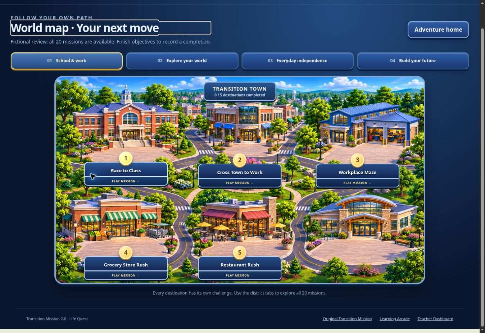
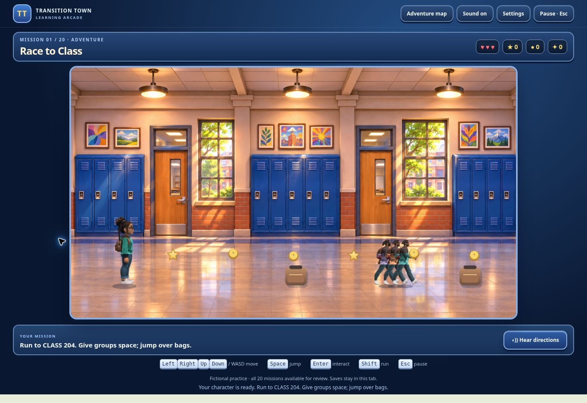

# Life Quest review verification — November 5, 2026

This revision updates draft PR #23. It does not merge, publish, deploy, change Site access or write live student records.

## Automated checks

```bash
npm install --prefix /tmp/life-quest-qa --no-save jsdom@26.1.0 esbuild@0.25.12
SCHOOL_JSDOM=/tmp/life-quest-qa/node_modules/jsdom node --test tests/life-quest.test.mjs tests/life-quest-polish.test.mjs tests/life-quest-dom.test.mjs tests/life-quest-keyboard-routes.test.mjs tests/transition-mission.test.mjs tests/school-release.test.mjs tests/job-missions.test.mjs tests/prism-pour-school.test.mjs
node tests/classroom-monitor.cjs
node tests/student-shop-core.cjs
node tools/release-audit.mjs
git diff --check
```

The full suite passes **233 tests**. Existing classroom and business suites pass **101** and **59** assertions. The release audit reports no syntax errors or missing active local references. The workflow includes added progression, sprite, route, startup-failure and customization regressions.

- Complete keyboard routes through all 20 missions in **Supported mode**, exact mid-mission close/reopen checks, and a complete campaign using one fictional saved Town avatar. These are automated DOM playthroughs, not 20 manual browser playthroughs.
- Full **Adventure and Challenge** commutes through the shipped keyboard handlers and saved resumption.
- **48** real-movement commute cases: four seeds, three difficulties and all four player speeds, without disabling collisions. Safe gaps, objectives, no-loss completion, two decisions and restored metadata are checked.
- Harder restaurant, grocery, budget and radio workloads require every objective. Both advanced box layouts are solved through actual legal pushes.
- Retries, replay variation, capped escalation, exact course restoration, malformed metadata and legacy checkpoints.
- All directional character frames render using saved appearance fields. Practice customization stays out of Town storage. A changed live identity clears evidence and locks the game.
- Remapping, native Tab, pause, speed, mute/volume, reduced decorative motion, truthful wrong/correct evidence and private reporting transport.
- Module-load failure produces one stable explanation without altering saves or automatically reloading.

## Browser review and limits

The portable practice build was checked in Chromium through an internal local preview. Home/portrait, world map, districts, traffic, hallway and furnished rooms were reviewed; movement, pause/settings, fictional customization, reports, reload and continuation were exercised. The actual modular launcher was also checked in fictional practice mode. The portable copy has no external script/style/image dependencies. Direct file-protocol opening is blocked by this cloud browser policy, so that specific path was not tested here; the identical portable HTML was tested over the internal HTTP preview. Verify opening the downloaded file on a classroom computer before classroom use.

The previous hosted preview displayed its sign-in wall before Life Quest ran; available error logs were empty. The precise earlier retry prompt was not reproduced. Its root cause is unconfirmed. The portable review removes the hosted/authentication dependency; this does not mean the hosted environment was repaired or redeployed.

`transition-mission.html`, `assets/transition-mission/`, shared learning storage, classroom services, rosters and financial records are unchanged. The workflow change adds tests and has no deployment step.

Artwork remains sprite/Canvas 2.5D, with runtime palette and supported hair/accessory variations. It is not a full 3D character editor or exact original-portrait recreation. Existing browser-local save and login/reporting limits remain. Physical school laptops, other browser families and real approved-device teacher synchronization require the separately approved pilot. Manual full-campaign play at every advanced setting is not claimed.

## Implemented views




