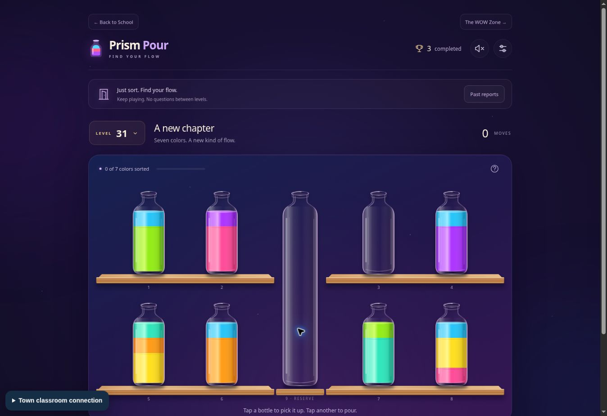

# Prism Pour in Transition Town School

Prism Pour is served directly from `prism-pour.html`, with 100 sorting levels, sixty transition questions, read-aloud, clues, teacher-recorded support, and printable session reports. It has no separate ChatGPT login or external game-host dependency.

Find it on the first shelf of School Directory → The WOW Zone, in the existing school hallway’s Educational Games room, and in the Digital Game & Simulator Zone. The game links back to the original school hallway and WOW Zone. The school artwork is preserved.

The original 30 puzzles and saved progress are preserved; levels 31–100 add 70 distinct, solvable puzzles. Both the level picker and lesson starting-level menu include all 100 levels, and level 100 wraps to level 1.

Noah and Clark’s named Town profiles always use **Sorting only**: the completion button goes straight to the next puzzle, with no questions or lesson setup. For a direct question-free link, open `prism-pour.html?mode=sort-only`. On a shared or guest device, choose **Just sort · no questions**, or turn on **Sorting only** in settings. This choice is saved with that profile. Switching to sorting only ends any active lesson as completed or ended early according to its actual recorded checkpoints, preserves the report, and keeps the current puzzle; it does not award unattempted answers. Other profiles can turn sorting only off in settings to use transition lessons again.

Each named Town profile has separate game and report storage on the current device. Its name is filled from the current visit. Guest and teacher practice use tab storage, matching the school’s existing learning records. No standalone-site records are copied across origins. Ending a lesson restores that profile’s prior puzzle progress.

The existing approved-device classroom monitor can record confirmed puzzle completions, transition question results, passed checkpoints and ended sessions. Its approval, pause, end-session and privacy controls are reused. Names and teacher notes in setup/report surfaces are marked private for live-view masking. Complete printable answer records remain in the game on the current device. These practice records do not certify mastery or replace teacher-reviewed observations.

Verification: `node --test tests/prism-pour-*.test.mjs`, the existing classroom monitor regressions, and `node tools/release-audit.mjs`. Browser checks cover navigation from the school directory, local modules and worker, setup, checkpoint progression, report preview and the return to school. A system print dialog is not exposed by the cloud QA browser.

The November 2 update was checked in the browser with all 100 level choices, Noah’s direct 30 → 31 progression and refresh, Clark’s prior checkpoint bypass and 100 → 1 wrap, a complete seven-pour sorting round, and Olivia’s three-question checkpoint into level 31. The direct sorting-only link also preserves an existing report without interrupting the puzzle.

